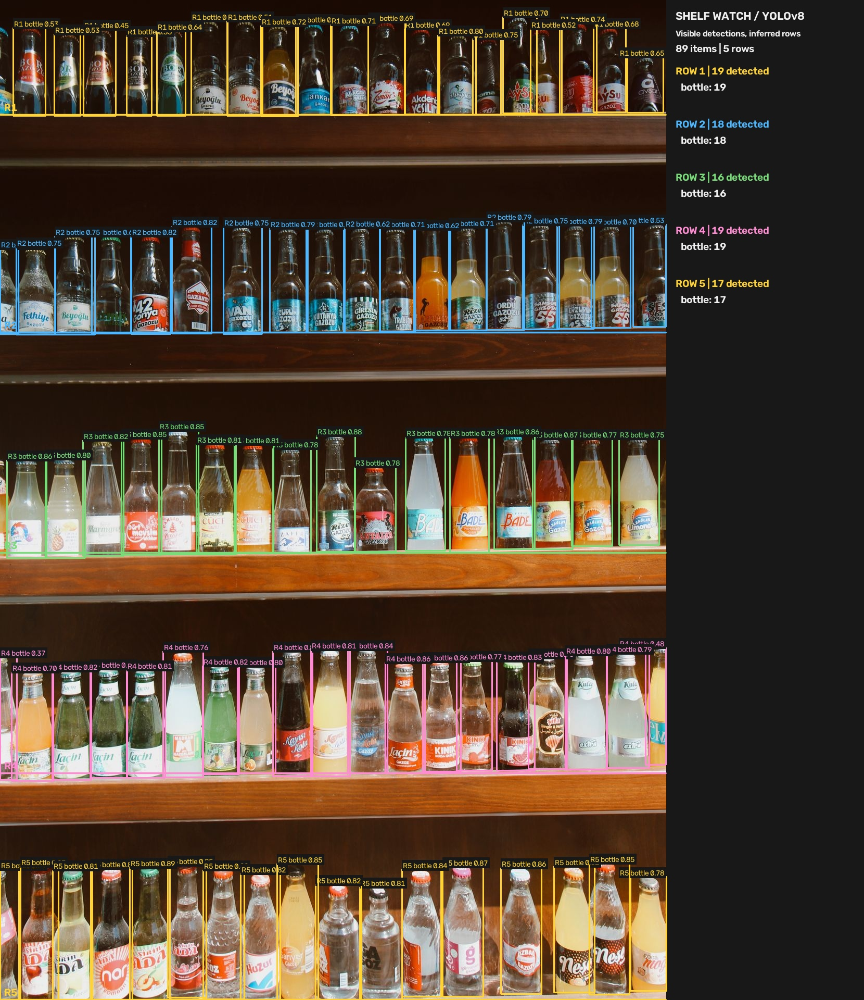
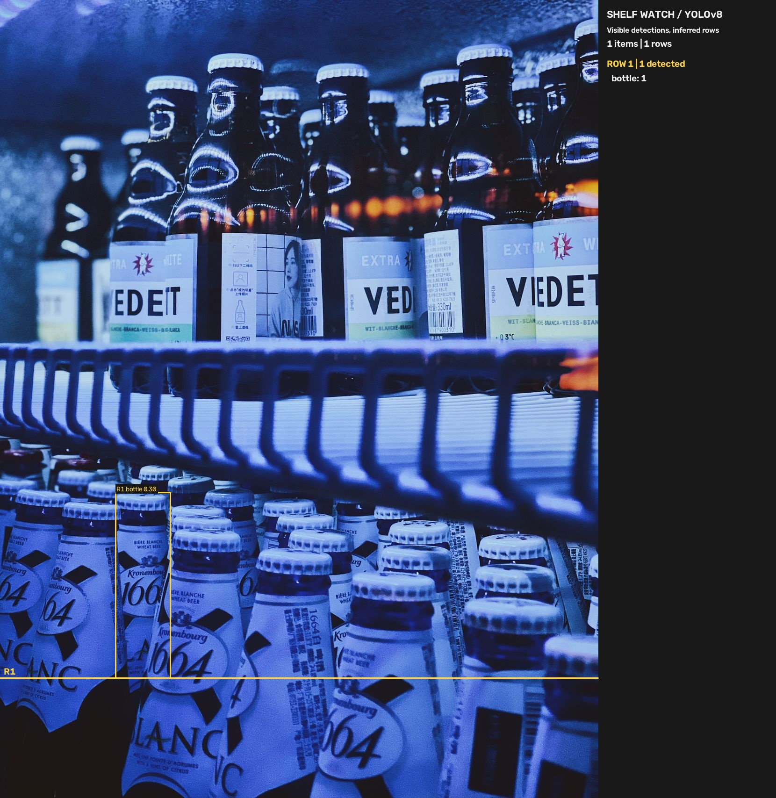
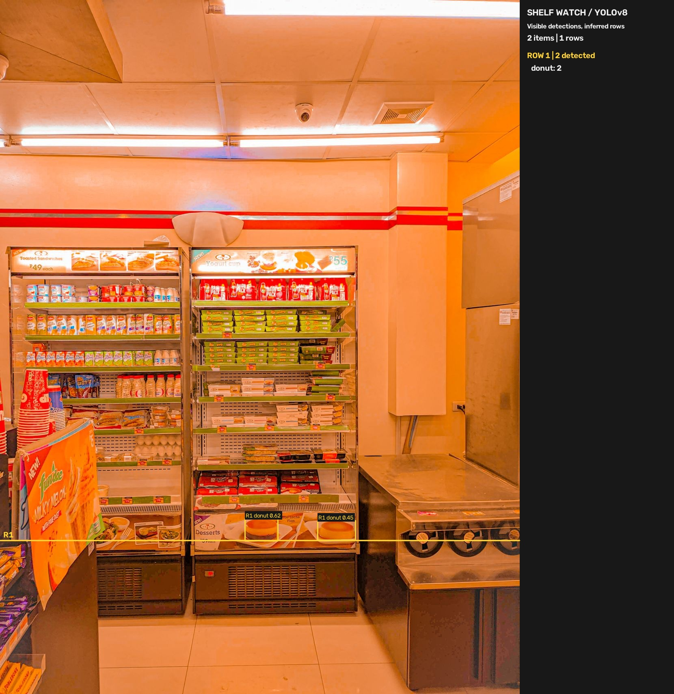

# Shelf Watch

**A photo → visible product detections → a tiny row/count planogram.**

Built by **Muhammad Abdulrehman** as a conversation piece for a job-application email to Zippin. At Drexel's McDonald Lab, I train YOLO and RF-DETR detectors for robot-arm vision. This small demo explores a related question: how can detections become a spatial inventory summary that a person can inspect?

The CLI runs a **pretrained COCO YOLOv8n** detector through Ultralytics, filters for product-like classes, groups detections into horizontal rows, and saves an annotated photo and JSON counts. No custom training, manual boxes, or fabricated inference results. This is an independent demo, with no Zippin affiliation or endorsement.

## Run

Python 3.10+ recommended; tested on Windows with Python 3.13, CPU inference. From this directory:

```powershell
python -m venv .venv
.\.venv\Scripts\python.exe -m pip install -r requirements.txt
.\.venv\Scripts\python.exe shelf_watch.py samples/shop_shelves.jpg samples/bottle_fridge.jpg samples/store_fridge.jpg
```

On macOS/Linux, use `.venv/bin/python` instead. The first inference downloads `yolov8n.pt` (internet required); subsequent runs can use the local weights offline. Weights and the virtual environment are excluded from git.

```powershell
# Your own shelf photo; optionally tighten the row grouping.
.\.venv\Scripts\python.exe shelf_watch.py my_shelf.jpg --conf 0.35 --row-tolerance 0.05 --output-dir my_results
# Use box centers instead of bottom edges, or select a narrower set of COCO classes.
.\.venv\Scripts\python.exe shelf_watch.py my_shelf.jpg --anchor center --classes bottle cup bowl apple banana
```

`--help` lists all controls, including `--imgsz` (default 1280), `--device` (default CPU), and `--model`. Default classes: bottle, wine glass, cup, bowl, banana, apple, sandwich, orange, broccoli, carrot, hot dog, pizza, donut, cake. COCO has no generic packaged-product, can, carton, or SKU class.

## What the files mean

For each input, `outputs/` receives:

- `<stem>_annotated.jpg`: boxes, class/confidence labels, colored row guides and a per-row count panel. Row colors repeat after four rows; row IDs remain distinct.
- `<stem>.json`: just `{ "row_1": { "bottle": 8 }, ... }`, ordered top to bottom. The example here illustrates the schema; the committed JSON files contain actual results.
- `<stem>_detections.json`: every accepted box, score and row assignment, plus model version and inference settings for inspection.

Rows are inferred **only from detected objects**, not from shelf segmentation. By default the anchor is each box's bottom y-coordinate, approximating where upright products rest. Sort anchors top to bottom and start a new row whenever adding an object would exceed a maximum vertical span of `0.08 × image height`. This bounds cluster spread and avoids merging many shelves through a chain of nearby points. `--anchor center` uses box centers instead. Each detection belongs to exactly one row; counts are simple class histograms. No detections produces `{}` and an annotated image that says so.

## Real example outputs

Generated by the command above, using the default `yolov8n.pt`, confidence 0.25, image size 1280, bottom anchors and row tolerance 0.08. These are model predictions, **not ground-truth counts or an accuracy benchmark**. Images link to full-size committed outputs; JSON links make the counts reviewable.

### Bottled drinks on shop shelves

The actual run found **89 bottle detections in five inferred rows**, with counts **19, 18, 16, 19, 17** from top to bottom. The row guides align well with this nearly frontal display. This is a useful positive example, but has no manually annotated ground truth.



[Planogram](outputs/shop_shelves.json) · [Raw detections and run settings](outputs/shop_shelves_detections.json)

### Bottles in a refrigerator

**Failure case:** just **one bottle detection** despite many visible bottles. The blue lighting, reflections and heavy occlusion defeat this pretrained model at the default threshold. Keeping this result exposes how badly a generic detector can undercount.



[Planogram](outputs/bottle_fridge.json) · [Raw detections and run settings](outputs/bottle_fridge_detections.json)

### Convenience-store refrigerated display

**Failure case:** the model returned **two `donut` detections on printed dessert pictures** near the bottom of the display, while missing the packaged stock. These are false inventory counts. The CLI faithfully reports them; a real retail system needs domain data and spatial/temporal checks to reject signage.



[Planogram](outputs/store_fridge.json) · [Raw detections and run settings](outputs/store_fridge_detections.json)

## Honest limitations / next steps

- COCO categories are broad: all brands of bottles collapse into `bottle`. Packaged food, cans and cartons are often missed or mislabeled. Pictures of food printed on signage can trigger detections too.
- Occlusion, reflections, dense arrangements, cropped products and lighting reduce recall. Counts represent accepted visible boxes, not total stock or units hidden behind the front row. Confidence scores are not calibrated probabilities of correctness.
- Perspective and camera tilt can split one physical shelf into several groups or merge different shelves. Bottle bases may be hidden by shelf rails; bottom anchors are an approximation. Empty physical shelves cannot be inferred from zero detections, and row IDs can change between photos.
- This is a static-photo prototype. It has no people tracking, item-removal events, temporal association, multi-camera calibration, sensor fusion, checkout logic, or production accuracy claim. It does not implement Zippin's system.
- A useful next experiment would annotate a small retail-specific validation set, measure per-class precision/recall and count error, then add calibrated shelf regions and a SKU-specific detector. Video association would be a separate step.

Validation performed: real CPU inference on all three samples; decoded each saved annotation; checked that every planogram count agrees with its raw detections, all accepted detections appear once, and every row obeys the configured y-span bound. Also checked empty-input row grouping, empty-detection rendering, CLI help, Python compilation and `pip check`. These checks verify the software plumbing, not detection accuracy.

## Photo sources and reuse

Three real photos are bundled at 1280 pixels wide, downloaded November 14, 2026. They were resized/compressed by Pexels' image service; annotations were added by this demo. Originals and annotations retain the underlying [Pexels License](https://www.pexels.com/license/), which permits free use and modification. This repository is an educational code example, not a stock-photo collection; photographers and pictured brands do not endorse it.

| Local sample | Photographer | Source |
| --- | --- | --- |
| `samples/shop_shelves.jpg` | Zeynep Şahin | [Drinks in Glass Bottles on Wooden Shelves in Shop](https://www.pexels.com/photo/drinks-in-glass-bottles-on-wooden-shelves-in-shop-14411720/) |
| `samples/bottle_fridge.jpg` | Shay Wang | [Beer Bottles in a Refrigerator](https://www.pexels.com/photo/beer-bottles-in-a-refrigerator-5992333/) |
| `samples/store_fridge.jpg` | Arthur Uzoagba | [Refrigerator with Shelves at a Store](https://www.pexels.com/photo/refrigerator-with-shelves-at-a-store-9074447/) |

For the exact download URLs, use `https://images.pexels.com/photos/<photo-id>/pexels-photo-<photo-id>.jpeg?w=1280&auto=compress&cs=tinysrgb` with the IDs in the source links.

## License

Demo code: copyright (c) 2026 Muhammad Abdulrehman, [AGPL-3.0-or-later](LICENSE). Photos are separately licensed as above. Ultralytics and its pretrained weights have their own [AGPL/enterprise licensing terms](https://www.ultralytics.com/license); review those before downstream commercial use. No model weights are redistributed here.
